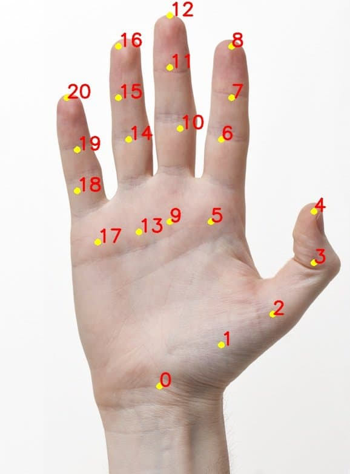

# Tricho Detector

A local, webcam-based awareness tool for **trichotillomania** (hair-pulling
disorder). It watches for the moment a hand comes into contact with hair, and
gives a gentle but hard-to-miss cue — a desktop notification and an optional
sound — so the behavior is interrupted before it becomes automatic.

Everything runs on your machine. No video is recorded, uploaded, or sent
anywhere.

---

## Why

Hair pulling usually happens outside awareness: while reading, thinking, on a
call. The first step in breaking the loop is *noticing* it. This app acts as a
second pair of eyes that never gets bored, and keeps a private log of when it
happened so patterns become visible over time.

It is a **wellness tool, not a medical device** — see the disclaimer at the
bottom.

---

## How it works

Every frame interval (100 ms by default) the app runs two models on the same
camera frame:

```
camera frame
   ├─ MediaPipe Hair Segmenter ──► hair mask ──► distance transform
   └─ MediaPipe Hand Landmarker ─► 21 landmarks ─► contact points

   contact point distance to hair  <  radius_px ?
                    │
                    ├─ no  ──► safe
                    └─ yes ──► dwell (N consecutive frames) ──► episode
                                                                (log + notify + sound)
```

**1. Hair segmentation.** MediaPipe's Hair Segmenter produces a binary
hair/background mask at the frame's resolution.

**2. Distance transform.** For every pixel we compute the distance to the
nearest hair pixel (`cv2.distanceTransform`). This is the key trick — see the
next section.

**3. Hand landmarks.** MediaPipe's Hand Landmarker returns 21 landmarks per
hand in normalized coordinates, which we map to frame pixels.

**4. Contact test.** For each *contact point* (fingertips and the knuckle just
before each tip), we look up the distance to the nearest hair pixel. If that
distance is below `radius_px`, the point is considered to be touching hair.

**5. Dwell time.** A single frame can flicker, so the app requires several
consecutive "touching" frames (3 by default) before it declares an episode.
This kills most false positives from landmark jitter.

**6. Alert + log.** When an episode starts, the app records it, shows a desktop
notification, and plays your chosen sound. Alerts are rate-limited by
`cooldown_seconds` so continuous pulling does not spam you.

### Why distance, not "is the fingertip inside the hair mask?"

The obvious approach — check whether the fingertip falls inside the hair
region — fails exactly when it matters. During a pull, **the hand occludes the
hair**, so the segmenter sees a hand-shaped hole in the mask. A fingertip at the
center of that hole would read as "not hair" precisely while the person is
pulling.

Measuring the distance to the *nearest* hair pixel sidesteps this: the hole is
bounded by hair, so a fingertip inside it is still only about half a finger
width from real hair. Occlusion stops being a problem by construction.

---

## Contact points

The Hand Landmarker numbers a hand's 21 keypoints `0`–`20` (`0` is the wrist):



The app checks **ten** of them by default: the five fingertips plus the DIP
joint just below each tip.

| Finger | Fingertip (TIP) | DIP joint |
|---|---|---|
| Thumb    | 4  | 3  |
| Index    | 8  | 7  |
| Middle   | 12 | 11 |
| Ring     | 16 | 15 |
| Pinky    | 20 | 19 |

**Why the DIP joints too?** When the fingers curl against the head, the tips
tuck underneath the hand and can end up far from the hair — even though the
knuckles are physically pressed against it. The DIP joints sit on the outside
of the curl, so they catch that case. Without them, a curled-finger pull can be
missed.

You can change the set in `config.json`: `contact_points` accepts any subset of
`0`–`20`. For example, a much stricter (fewer false positives) configuration:

```json
"contact_points": [4, 8, 12, 16, 20]
```

Or a very permissive one that also includes the PIP and MCP knuckles:

```json
"contact_points": [4, 8, 12, 16, 20, 3, 7, 11, 15, 19, 6, 10, 14, 18, 5, 9, 13, 17]
```

More points means higher recall and more false positives; it is a single knob.

---

## Features

- **Live camera preview** with the hair mask and every contact point overlaid,
  so you can see exactly what the detector sees.
- **Desktop notification + optional sound** when an episode starts.
- **Configurable** contact points, radius, frame rate, cooldown, notification
  text, and sound file — editable in the GUI or in `config.json`.
- **Activity calendar**: a GitHub-style yearly heatmap of pulls per day.
- **Streak timer**: "I have not pulled my hair in X days, Y hours, …",
  reset by every pull.
- **100% local**: no account, no server, no cloud.

---

## Install

Requires **Python 3.10+**.

```bash
# Linux / macOS
bash install.sh

# Windows
install.bat
```

Or directly:

```bash
python install.py
```

The installer creates a `.venv`, installs the pinned dependencies, downloads the
two MediaPipe models into `models/`, and creates `config.json` on first run.
It is safe to re-run: existing environments, models, and settings are reused.

---

## Run

**Desktop app (recommended):**

```bash
# Linux / macOS
.venv/bin/python gui.py

# Windows
.venv\Scripts\python gui.py
```

The app opens with three tabs:

| Tab | What it does |
|---|---|
| **Camera** | Live preview; the status bar turns red while pulling is detected |
| **Settings** | Edit all tunables, then **Save**. **Reset to Defaults** restores the form |
| **Activity** | Yearly heatmap, streak timer, and the feedback link |

Saving settings hot-applies them — no restart needed.

> Desktop notifications are suppressed by your OS's **Do Not Disturb / Focus**
> mode. The in-app status bar (and the sound, if configured) still work.

**Command line:**

```bash
.venv/bin/python detect.py                 # console + OpenCV preview window
.venv/bin/python detect.py --no-display    # console only
```

---

## Configuration

Settings live in `config.json` next to the scripts. The GUI writes this file;
you can also edit it by hand.

| Key | Default | Meaning |
|---|---|---|
| `contact_points` | `[4, 8, 12, 16, 20, 3, 7, 11, 15, 19]` | Landmark indices to test (0–20) |
| `cooldown_seconds` | `5.0` | Minimum seconds between alerts |
| `frame_interval_ms` | `100` | Milliseconds between processed frames (100 = 10 FPS) |
| `radius_px` | `12.0` | Max distance from a contact point to hair, in frame pixels |
| `notification_title` | `"Stop pulling your hair!"` | Notification heading |
| `notification_message` | `"Take a breath and move your hand away."` | Notification body |
| `sound_path` | `""` | Path to a `.wav` / `.mp3` / `.ogg` / `.flac` file, played with each alert; empty = silent |

Two notes:

- **`radius_px` is in frame pixels**, so it depends on the camera resolution.
  If you change resolution, re-tune it. 12 px at 720p is fairly tight; 15–30 is
  a reasonable range for most people.
- **The CLI-only `--dwell-frames`** flag (default 3) controls how many
  consecutive frames are needed before an episode is declared. It is not in
  `config.json`.

---

## Activity tracking

Episodes are counted once per pull *episode* (the rising edge of the detected
state), not once per frame. Data is stored in `activity.json`:

```json
{
  "last_pull": "2026-10-30T14:25:00",
  "2026": {
    "2026-10-29": 1,
    "2026-10-30": 3
  }
}
```

- Top-level keys are **years**; a new year is created automatically.
- Each year maps ISO dates to the number of pulls that day (only non-zero days
  are stored).
- `last_pull` is the timestamp of the most recent pull, used by the streak
  timer.

The heatmap starts **bright green** `(0, 255, 0)` for a day with no pulling.
Every pull removes 10 from the green channel, so 26+ pulls in a day is black:
the more you pull, the more the reward drains out of the calendar.

Delete `activity.json` to start with a clean history.

---

## Project layout

```
tricho_detector/
├── gui.py                    # PySide6 app: Camera / Settings / Activity
├── detect.py                 # command-line runner
├── detector.py               # shared core: models, decision logic, alerts
├── activity.py               # per-day counters + last_pull
├── heatmap.py                # yearly heatmap widget
├── sound.py                  # cross-platform sound playback
├── install.py                # cross-platform installer
├── install.sh / install.bat  # installer wrappers
├── config.json               # user settings
├── activity.json             # pull history (created on first pull)
├── requirements.txt          # pinned dependencies
├── handpose-demo-keypoints.jpg
└── models/
    ├── hair_segmenter.tflite
    └── hand_landmarker.task
```

---

## Requirements and platform support

- **Python 3.10+**
- **Webcam** (built-in or USB)
- No GPU required — both models run on CPU

| Platform | Status |
|---|---|
| Windows 10/11 (x86-64, ARM64) | Supported |
| macOS 11+ (Apple Silicon) | Supported |
| Linux (glibc 2.28+, x86-64 / ARM64) | Supported |
| macOS on Intel | Not supported (MediaPipe ships arm64-only wheels) |
| Android / iOS | Not supported (no Python MediaPipe; background camera is also restricted on mobile) |

The two MediaPipe models are Apache-2.0 licensed. They are downloaded by the
installer and are not committed to this repository.

---

## Privacy

- Camera frames are processed in memory and discarded immediately.
- Nothing is recorded, uploaded, or sent to any server.
- `activity.json` stores only *counts per day* and the timestamp of the last
  pull — no images, no video, no location.
- The feedback link opens an external Google Form in your browser; nothing is
  sent unless you choose to submit it.

---

## Disclaimer

This is an awareness and habit-interruption aid, **not a medical device**. It
cannot diagnose trichotillomania, and it cannot reliably tell a hair pull from
scratching, adjusting glasses, or resting your head on your hand. It is not a
substitute for professional care.

If hair pulling is affecting your life, speak to a doctor or mental-health
professional. Trichotillomania is treatable, and habit-reversal therapy in
particular has good evidence behind it.

---

## Feedback

Found a bug, or have an idea? Use the **Contact us** link at the bottom of the
Activity tab, or open the form directly:

<https://docs.google.com/forms/d/e/1FAIpQLSfDUIuLhHDg1paNdIf2CJqjNX1tQKJW5cqKV-TVLTISETO0Cw/viewform?usp=publish-editor>
